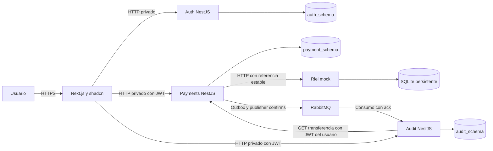
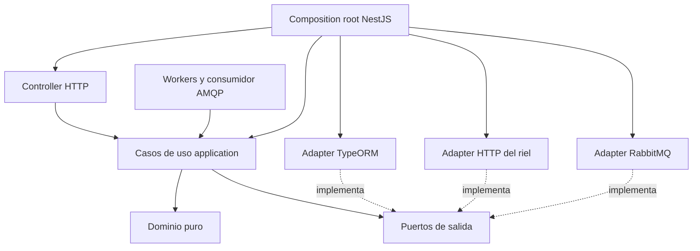
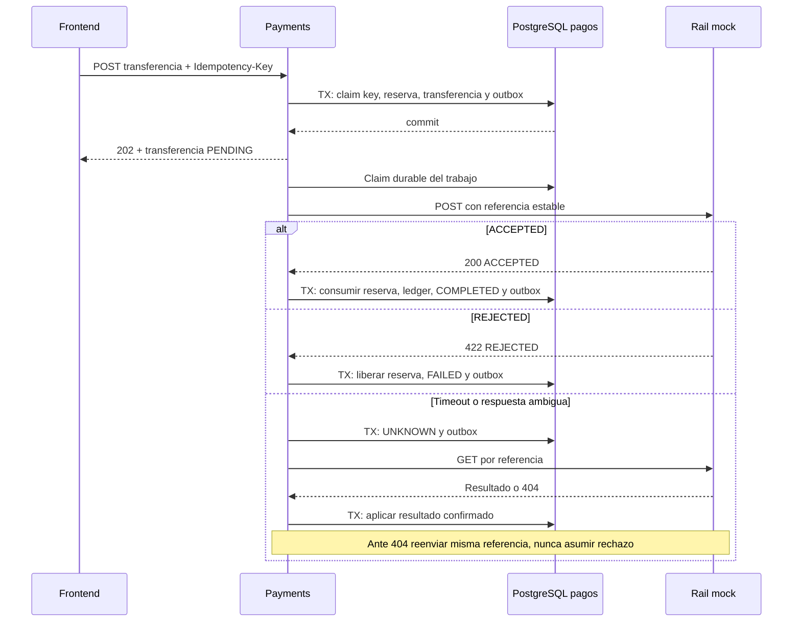
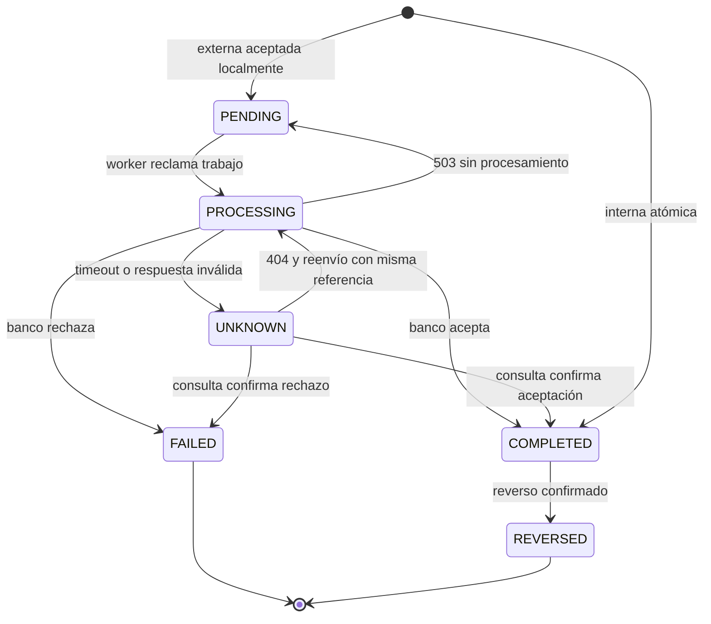

# Arquitectura hexagonal

## Servicios y responsabilidad

| Proceso | Responsabilidad | Datos exclusivos | Entradas/salidas |
|---|---|---|---|
| web | UI, sesión browser, proxy HTTP del mismo origen | cookies HttpOnly; sin tablas | browser ↔ Next.js ↔ APIs |
| auth | usuarios, passwords, sesiones/rotación | auth_schema | REST; emite JWT RS256 |
| payments | cuentas, transferencias, reversos, ledger, idempotencia y outbox | payment_schema | REST, HTTP rail, AMQP |
| audit | consumo deduplicado y consultas autorizadas | audit_schema | AMQP y REST; consulta autorización en payments |
| rail-mock | simular banco, deduplicar referencias y responder fallos | SQLite en volumen exclusivo | solo HTTP interno |
| PostgreSQL | persistencia transaccional | tres esquemas/roles sin acceso cruzado | red privada |
| RabbitMQ | transporte durable de eventos | volumen del broker | AMQP interno |

El mock es un servicio de soporte; no reemplaza ninguno de los tres microservicios requeridos. Workers de conciliación y outbox viven en payments para limitar complejidad. Tener varias réplicas exige claims/leases en DB, sin coordinación en memoria.

## Contenedores y flujo



Audit obtiene autorización consultando `GET /api/v1/transfers/{id}` en payments con el JWT original. Si payments no está disponible, falla cerrado con 503; si no hay acceso devuelve 404. No lee payment_schema ni confía solo en un ID recibido del browser. La consulta no produce eventos de dominio y evita un bucle de auditoría.

## Capas por microservicio



Las flechas sólidas representan dependencias. Infrastructure depende de application/domain; domain no conoce infraestructura. Puertos de payments: AccountsRepository, TransfersRepository, ReversalsRepository, IdempotencyStore, UnitOfWork, BankRail, OutboxStore, Clock e IdGenerator. El publicador consume outbox; no lo invocan transacciones de negocio.

```text
apps/
  auth/src/{domain,application,infrastructure,bootstrap}/
  payments/src/{domain,application,infrastructure,bootstrap}/
  audit/src/{domain,application,infrastructure,bootstrap}/
  rail-mock/src/
  web/src/
packages/
  api-client/        # generado de OpenAPI, sin entidades de negocio
  event-contracts/   # schemas versionados, sin adapters
infra/              # init PostgreSQL y Dockerfiles cuando se implemente
docs/
```

DTO HTTP y entities TypeORM se mapean al dominio. UnitOfWork entrega repositorios asociados al mismo EntityManager transaccional: usar un repository global dentro del callback rompería atomicidad.

## Transferencia externa y respuesta desconocida



## Máquina de estados



Un reverso tiene máquina independiente PENDING → PROCESSING → COMPLETED/FAILED/UNKNOWN; PROCESSING → PENDING ante 503; UNKNOWN → PROCESSING/COMPLETED/FAILED. La transferencia permanece COMPLETED mientras el reverso no esté confirmado. El body incluye `reversal` para distinguir solicitud pendiente, fallida o exitosa.

## Garantías y límites

- Atomicidad local de saldos/ledger/estado/outbox; entrega de eventos al menos una vez y deduplicación en destino.
- Progreso eventual cuando DB, broker y banco se recuperan. No prometer finalización acotada durante fallos persistentes.
- Reinicios de workers recuperan leases expirados. Después de una llamada ambigua se consulta antes de reenviar.
- La demo en una VPS no es alta disponibilidad. Volúmenes no sustituyen backups.
- Consultas autorizadas a audit tienen dependencia de disponibilidad de payments; es un tradeoff explícito para evitar replicar ACL en v1.

## Swagger y API First

Cada aplicación NestJS monta Swagger UI en /docs y JSON en /docs-json con @nestjs/swagger; carga el contrato raíz y filtra operaciones por su tag Auth/Payments/Audit, preservando components y security. No hay generación desde implementación que reemplace la fuente YAML. Dentro de Swagger usar server relativo /api/v1 para Try it out sobre el mismo servicio. Los servicios continúan privados en Compose/Dokploy.
