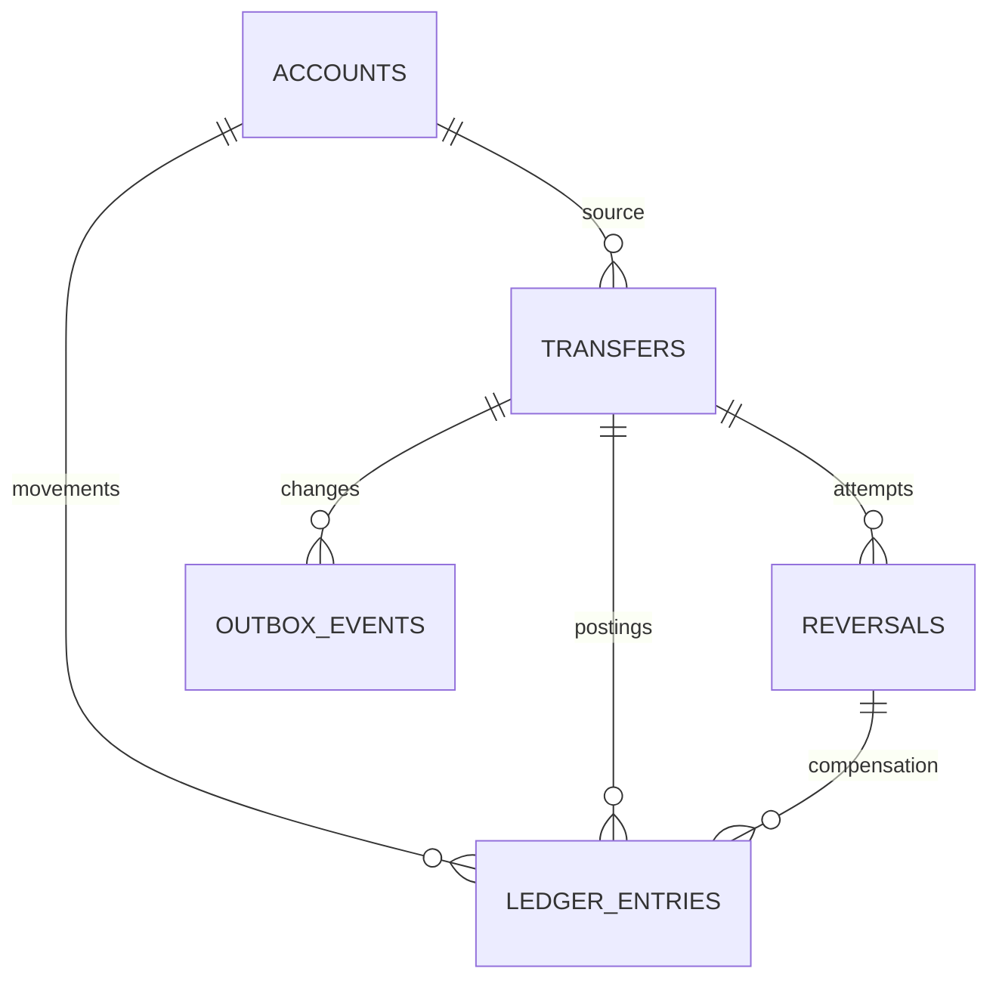

# Modelo de datos y consistencia

## Propiedad

| Esquema | Tablas objetivo | Rol runtime |
|---|---|---|
| auth_schema | users, sessions | auth_app |
| payment_schema | accounts, external_beneficiaries, transfers, reversals, ledger_entries, idempotency_records, outbox_events | payments_app |
| audit_schema | audit_events | audit_app |

Un usuario PostgreSQL administrador solo inicializa esquemas, owners y roles; no lo usan servicios. Rol migrador por esquema; roles runtime con DML limitado. Revocar acceso público innecesario y probar denegaciones cruzadas. Sin FKs entre esquemas; `owner_id` y `actor_id` son UUID de identidad, no relaciones ORM a auth.

## Relaciones principales

## Dinero

- API recibe string positivo: `100.00`. Aceptar una o dos cifras decimales o entero textual y normalizar a dos; rechazar separadores de miles, coma, notación científica, espacios y más de dos decimales.
- PostgreSQL usa bigint en centavos para montos, saldos y reservas; dominio bigint. API serializa strings decimales. Nunca pasar bigint directamente a JSON.
- Máximo por monto/saldo: 999999999999.99 COP; validar rango al debitar y acreditar.
- `balance_minor >= 0`, `reserved_minor >= 0`, `reserved_minor <= balance_minor`. Disponible = balance - reserved.
- Ledger: `direction` DEBIT/CREDIT, `amount_minor > 0`, cuenta, transferencia, reverso opcional, tipo y timestamp. Movimientos inmutables; unicidad por operación/cuenta/tipo evita doble contabilización.
- Una reserva no es un débito confirmado: aceptación reduce balance y reserva; rechazo solo reduce reserva. No utilizar una reserva para cubrir otra transferencia.
- Interna: dos movimientos compensados. Externa: movimiento local contra contraparte bancaria; no crear saldo local del beneficiario externo.

## Tablas e índices críticos

- accounts: UUID, `code` único (ACC-001 etc.), owner UUID, balance/reserved bigint, timestamps.
- external_beneficiaries: códigos `EXT-001`, `EXT-002`, nombre, estado activo. Catálogo igual al mock; sin CRUD público v1.
- transfers: UUID, actor, source FK local, destination kind/code, monto, moneda COP, estado, secuencia, referencia bancaria única, datos de lease y próximo intento, timestamps. FK destino solo para internas mediante columna nullable.
- reversals: UUID, transferencia, actor, monto completo, estado, referencia bancaria única, lease/reintentos. Índice único parcial por transferencia para estados PENDING/PROCESSING/UNKNOWN/COMPLETED; FAILED permite un nuevo intento con nueva key.
- idempotency_records: clave compuesta única `(subject_id, operation, key)`, hash SHA-256 de campos semánticos normalizados, status HTTP y body de resultado. No expirar durante v1.
- outbox_events: event UUID, transferencia, secuencia, payload, published_at, attempts, next_attempt_at, lease_until. Único por transferencia/secuencia.
- audit_events: eventId PK, transferencia, secuencia, tipo, actor, ocurrió/recibido, payload. Único transferencia/secuencia; duplicado exacto es no-op, conflicto de contenido se aísla como corrupción.
- users: UUID, email normalizado único, password hash, timestamps.
- sessions: UUID/family, user UUID, hash de refresh, expiración, revoked_at, rotated_to. Nunca guardar refresh en claro.

## Algoritmo idempotente

1. Validar JWT, sintaxis y header; consultas a recursos ajenos devuelven 404. Estas respuestas no consumen key.
2. Abrir transacción y crear idempotency record usando índice único. Una carrera espera el commit de la primera petición; consultar registro en una nueva sentencia tras el conflicto.
3. Si existe: hash distinto → 409 IDEMPOTENCY_CONFLICT; mismo hash → replay de status/body originales. GET permite observar estado actual, no mutar el snapshot del POST.
4. Si somos propietarios de la key, bloquear cuentas por UUID ascendente y comprobar reglas. Guardar respuesta de errores de negocio definitivos (404/409/422) y commit sin dinero ni transferencia; la key queda consumida.
5. Si válida: escribir operación, efectos locales y outbox; guardar respuesta (201 interna o 202 externa) y commit juntos.
6. Caída antes de commit: nada durable; cliente puede repetir key. Caída después de commit: replay recupera respuesta.
7. Error técnico que aborta TX no consume key ni devuelve éxito; HTTP 503 y reintento con la misma key. Deadlocks/serialization failures permiten máximo tres reintentos completos con la misma key.

Operación de idempotencia de reverso incluye el ID de transferencia en el hash; reutilizar la key para otra transferencia produce conflicto. Canonicalización ignora orden JSON; rechaza campos desconocidos. No incluir timestamps ni headers en el hash.

## Trabajo durable y recuperación

Seleccionar trabajo vencido con `FOR UPDATE SKIP LOCKED`, lease de 30 s, identificador de intento y CAS/version para aplicar resultado. Llamada al banco fuera de TX. Si cae un worker después de enviar, el siguiente consulta antes de reenviar. Aplicación del resultado vuelve a bloquear la transferencia y verifica estado/versión; un resultado repetido no genera ledger ni evento duplicado.

Reserva y datos para enviar se guardan antes de llamar al banco. Para 503 usar backoff 1/2/4/8/16/30 s con jitter; UNKNOWN consulta cada 5 s y retrocede hasta 30 s al fallar. Sin máximo que libere fondos automáticamente. Tras 20 intentos registrar alerta y continuar conciliación. Mostrar pending/unknown al usuario.

## Seeds

- Demo A: ACC-001 = 1000000.00 COP y ACC-003 = 0.00 COP.
- Demo B: ACC-002 = 500000.00 COP.
- Registrar movimiento de apertura por cuenta con referencia única de seed, sin evento de transferencia ficticio.
- Seed idempotente por códigos/emails; jamás sobrescribir saldos o passwords en un arranque posterior.
- Nueva identidad: payments crea una cuenta en cero mediante `POST /accounts/bootstrap` autenticado tras login. El BFF lo invoca al iniciar sesión; unicidad owner/rol de cuenta garantiza idempotencia sin key financiera. `GET /accounts` es solo lectura. Si payments falla, mostrar reintento de bootstrap; no llamadas auth → payments durante registro.
