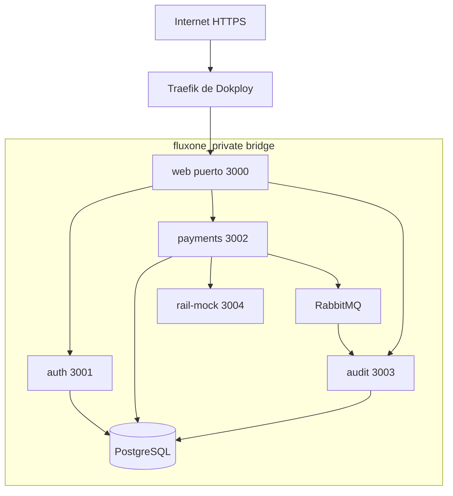

# Despliegue objetivo: Compose y Dokploy

Estado: infraestructura de backend construida y arrancada localmente; web/mock pendientes de integrar. Ver README para comandos ejecutados.

## Servicios del archivo docker-compose.yml

| Servicio | Puerto interno | Persistencia / readiness |
|---|---|---|
| web | 3000 | /api/health; conexión a APIs internas |
| auth | 3001 | /health/live y /health/ready; DB de auth |
| payments | 3002 | /health/live y /health/ready; DB de pagos |
| audit | 3003 | /health/live y /health/ready; DB de audit |
| rail-mock | 3004 | SQLite /data/rail.sqlite; /health/ready |
| postgres | 5432 | volumen postgres_data; pg_isready |
| rabbitmq | 5672 | volumen rabbitmq_data; rabbitmq-diagnostics |
| init-db | one-shot | roles/esquemas idempotentes; privilegios admin solo aquí |
| migrate-auth / migrate-payments / migrate-audit | one-shot | cada uno su esquema y credencial migradora |
| seed | one-shot | ejecuta seed separado por servicio; no lee esquemas cruzados |

init-db espera postgres healthy; migrations esperan init completado; seed espera migrations; apps esperan seed (que ya depende de migrations). Worker de pagos soporta broker/mock temporalmente caídos; no exigir broker healthy para servir transferencias internas. Audit responde readiness degraded si consumidor no conecta, conserva liveness si puede recuperarse. Liveness no consulta dependencias; readiness indica qué capacidad está disponible. Inicialización del mock aplica su migración SQLite antes de ready.

Health HTTP sin autenticación en red privada: live devuelve 200 si el proceso puede responder; ready devuelve 200 si puede servir su capacidad base y 503 si no. Body `{status: "ok" | "degraded", service: string}`. No exponer DSNs ni secretos en salud. Para payments, DB caída impide readiness; broker caído se observa como capacidad de auditoría degradada en logs/métricas sin bloquear el core.

## Redes y exposición

Solo web publica puerto local `${WEB_PORT:-3000}:3000`. En Dokploy, web se conecta además a la red externa `dokploy-network`; el override de despliegue agrega esa red/labels y elimina el binding público local si se usa Traefik. Base Compose arranca local sin necesitar la red de Dokploy. No publicar DB, AMQP, management ni mock en internet.

El override no agrega .env por aplicación: ambos archivos Compose usan la misma fuente raíz. `docker-compose.dokploy.yml` es una extensión de infraestructura planeada, no una segunda pila independiente.

## Un único .env

Configurar valores en Dokploy para materializar `.env` junto al Compose; interpolar mediante `environment` explícito por servicio, no `env_file` completo en todos. No versionar `.env`; `.env.example` sí, con placeholders no funcionales para secretos de producción.

Variables objetivo:

| Grupo | Variables |
|---|---|
| General | NODE_ENV, APP_ORIGIN, WEB_PORT, LOG_LEVEL |
| DB bootstrap | POSTGRES_DB, POSTGRES_USER, POSTGRES_PASSWORD |
| Roles runtime | AUTH_DB_USER, AUTH_DB_PASSWORD, PAYMENTS_DB_USER, PAYMENTS_DB_PASSWORD, AUDIT_DB_USER, AUDIT_DB_PASSWORD |
| Roles migración | AUTH_MIGRATION_USER, AUTH_MIGRATION_PASSWORD, PAYMENTS_MIGRATION_USER, PAYMENTS_MIGRATION_PASSWORD, AUDIT_MIGRATION_USER, AUDIT_MIGRATION_PASSWORD |
| JWT | JWT_PRIVATE_KEY_B64, JWT_PUBLIC_KEY_B64, JWT_ISSUER, JWT_AUDIENCE |
| Broker | RABBITMQ_USER, RABBITMQ_PASSWORD |
| Demo | DEMO_A_ID, DEMO_B_ID, DEMO_A_EMAIL, DEMO_B_EMAIL, DEMO_A_PASSWORD, DEMO_B_PASSWORD |
| Mock | RAIL_MODE, RAIL_SCENARIOS |

Hosts y puertos internos derivan de nombres de servicio en Compose; no duplicar configuración de red en browser. Solo auth recibe private key; payments/audit reciben public key. Web solo URLs privadas y APP_ORIGIN; no recibe credenciales de DB/broker ni private key. Ningún secreto con prefijo NEXT_PUBLIC_. Generación inicial de keys/UUIDs/secrets resuelta con tools/setup-env.mjs, que crea solo `.env` cuando falta.

## Seguridad y operación mínima

Builds multi-stage, runtime no-root cuando imagen lo permita, dependencias fijadas por lockfile y tags exactos elegidos en bootstrap, graceful shutdown y restart unless-stopped para servicios permanentes. No restart para migrations fallidas: impedir arrancar apps sobre schema incompleto.

Credenciales admin fuera de apps. Respaldar DB y volumen SQLite antes de cambios destructivos. No ejecutar down -v en VPS. Logs stdout JSON, IDs de correlación y sin tokens. Rotación de secretos o tags requiere redeploy; no regenerarlos en cada arranque.

## Guía de validación

1. Clon limpio + setup de .env + docker compose up --build -d, en menos de cinco comandos de usuario.
2. Verificar health, login demo, saldos iniciales y una interna/externa/reverso.
3. Reiniciar sin borrar volúmenes: conservar usuarios, saldos, resultados bancarios y eventos.
4. Detener broker: pagar interna; recuperar broker y comprobar auditoría eventual.
5. Dokploy: dominio y HTTPS definidos durante despliegue real, red de entrada existente, variables raíz, override y smoke desde URL pública.

No conocemos dominio ni recursos de VPS. Esos datos no bloquean documentación ni Compose local, pero deben comprobarse antes de desplegar. No afirmar despliegue realizado sin URL y smoke exitoso.

## Evidencia y configuración dev actual

Imagen backend multi-stage construida y auth/payments/audit en ejecución con healthchecks y Swagger. docker-compose.dev.yml publica APIs en 3101/3102/3103 por defecto y PG/AMQP en 15432/15672, siempre loopback; puertos internos siguen 3001/3002/3003, 5432 y 5672. El puerto 3001 estaba ocupado por otro proceso y se dejó intacto. tools/setup-env.mjs genera .env solo si falta.

El override de Dokploy todavía debe prepararse cuando se conozca la entrada web y se integren auxiliares; no existe despliegue VPS verificado. No se atribuye arranque completo a una prueba parcial de backend.
