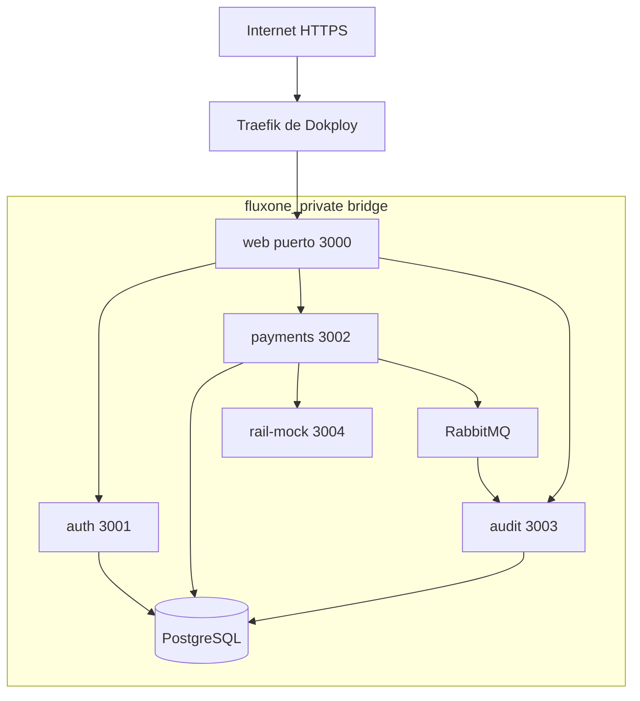

# Despliegue: Compose y Dokploy

Estado: los 12 servicios, sus dependencias, redes y volúmenes están definidos en Compose. El stack local completo reconstruyó y quedó healthy; el smoke entre procesos también se aprobó en un proyecto Compose aislado. Desplegado en Dokploy el 2026-10-15 desde el commit `6a71e46`. El dominio `central-banking-system.dokploywill.dpdns.org` apunta al servicio `web:3000`, usa HTTPS con el resolver `letsencrypt` y está detrás de Cloudflare. Tras configurar el dominio se volvió a desplegar Compose para que Dokploy añadiera las labels de Traefik. Verificación pública posterior: `/` respondió 307 hacia `/accounts`, `/login` respondió 200 y `/api/health` respondió 200 con `{"status":"ready"}`. En Dokploy, `web`, `auth`, `payments`, `audit`, `postgres`, `rabbitmq` y `rail-mock` quedaron healthy; `init-db`, migrations y seed terminaron con código 0. No se reiniciaron volúmenes.

## Servicios del archivo docker-compose.yml

| Servicio | Puerto interno | Persistencia / readiness |
|---|---|---|
| web | 3000 | /api/health; conexión a APIs internas |
| auth | 3001 | /health/live y /health/ready; DB de auth |
| payments | 3002 | /health/live y /health/ready; DB de pagos |
| audit | 3003 | /health/live y /health/ready; DB de audit |
| rail-mock | 3004 | SQLite /data/rail.sqlite; /health/ready |
| postgres | 5432 | volumen postgres_data; pg_isready |
| rabbitmq | 5672 | volumen rabbitmq_data; rabbitmq-diagnostics |
| init-db | one-shot | roles/esquemas idempotentes; privilegios admin solo aquí |
| migrate-auth / migrate-payments / migrate-audit | one-shot | cada uno su esquema y credencial migradora |
| seed | one-shot | ejecuta seed separado por servicio; no lee esquemas cruzados |

init-db espera postgres healthy; migrations esperan init completado; seed espera migrations; apps esperan seed (que ya depende de migrations). Worker de pagos soporta broker/mock temporalmente caídos; no exigir broker healthy para servir transferencias internas. Audit responde readiness degraded si consumidor no conecta, conserva liveness si puede recuperarse. Liveness no consulta dependencias; readiness indica qué capacidad está disponible. Inicialización del mock aplica su migración SQLite antes de ready.

Health HTTP sin autenticación en red privada: live devuelve 200 si el proceso puede responder; ready devuelve 200 si puede servir su capacidad base y 503 si no. Body `{status: "ok" | "degraded", service: string}`. No exponer DSNs ni secretos en salud. Para payments, DB caída impide readiness; broker caído se observa como capacidad de auditoría degradada en logs/métricas sin bloquear el core.

## Redes y exposición en Dokploy

El Compose base solo declara `expose: 3000` para web; no publica puertos al host. En despliegue local, `docker-compose.dev.yml` publica web y las APIs en loopback. Para producción, crea la aplicación como **Docker Compose** (no Docker Stack: las imágenes de este repo se construyen con `build`) y configura el dominio en la pestaña Domains de Dokploy con puerto destino 3000 y HTTPS. Dokploy añade las labels de Traefik y conecta el servicio web a su red de entrada. No hacen falta labels ni una red externa de Dokploy escritos a mano. No publicar DB, AMQP, management, APIs ni mock en internet.

El mismo `docker-compose.yml` contiene todos los servicios para local y producción. No usar `docker-compose.dev.yml` en Dokploy: solo ese override publica puertos locales. Compose conserva la red privada de servicios y volúmenes con nombre para Postgres, RabbitMQ y el rail mock.

## Un único .env

Pega el contenido del `.env.dokploy` local en el editor Environment del proyecto Compose en Dokploy; Dokploy lo guarda como `.env` junto al Compose. Ese archivo local tiene secretos de producción, está excluido de Git y debe conservarse para recuperar las credenciales demo. `.env.example` es solo una plantilla segura con placeholders. Compose no inyecta automáticamente todas las variables a todos los contenedores: las asigna explícitamente por servicio para limitar secretos.

Variables objetivo:

| Grupo | Variables |
|---|---|
| General | NODE_ENV, APP_ORIGIN, LOG_LEVEL; `WEB_PORT` solo en desarrollo |
| DB bootstrap | POSTGRES_DB, POSTGRES_USER, POSTGRES_PASSWORD |
| Roles runtime | AUTH_DB_USER, AUTH_DB_PASSWORD, PAYMENTS_DB_USER, PAYMENTS_DB_PASSWORD, AUDIT_DB_USER, AUDIT_DB_PASSWORD |
| Roles migración | AUTH_MIGRATION_USER, AUTH_MIGRATION_PASSWORD, PAYMENTS_MIGRATION_USER, PAYMENTS_MIGRATION_PASSWORD, AUDIT_MIGRATION_USER, AUDIT_MIGRATION_PASSWORD |
| JWT | JWT_PRIVATE_KEY_B64, JWT_PUBLIC_KEY_B64, JWT_ISSUER, JWT_AUDIENCE |
| Broker | RABBITMQ_USER, RABBITMQ_PASSWORD |
| Demo | DEMO_A_ID, DEMO_B_ID, DEMO_C_ID, DEMO_A_EMAIL, DEMO_B_EMAIL, DEMO_C_EMAIL, DEMO_A_PASSWORD, DEMO_B_PASSWORD, DEMO_C_PASSWORD |
| Mock | RAIL_MODE, RAIL_SCENARIOS |

Hosts y puertos internos derivan de nombres de servicio en Compose; no duplicar configuración de red en browser. Para Dokploy define `APP_ORIGIN=https://central-banking-system.dokploywill.dpdns.org` sin slash final, `NODE_ENV=production` y secretos/UUIDs fuertes. Solo auth recibe private key; payments/audit reciben public key. Web solo URLs privadas y APP_ORIGIN; no recibe credenciales de DB/broker ni private key. Ningún secreto con prefijo NEXT_PUBLIC_. Los IDs y contraseñas demo deben permanecer estables entre despliegues para que el seed idempotente no cree identidades nuevas; cambia contraseñas reiniciando las credenciales por un procedimiento deliberado, no regenerando variables al desplegar.

## Seguridad y operación mínima

Builds multi-stage, runtime no-root cuando imagen lo permita, dependencias fijadas por lockfile y tags exactos elegidos en bootstrap, graceful shutdown y restart unless-stopped para servicios permanentes. No restart para migrations fallidas: impedir arrancar apps sobre schema incompleto.

Credenciales admin fuera de apps. Los volúmenes conservan Postgres, RabbitMQ y SQLite entre despliegues: cambiar `POSTGRES_PASSWORD` o `RABBITMQ_PASSWORD` en Dokploy por sí solo no rota credenciales ya inicializadas ni existentes. Configúralas antes del primer despliegue y usa un procedimiento de rotación acorde al servicio si se cambian. Respaldar DB y volumen SQLite antes de cambios destructivos. No ejecutar down -v en VPS. Logs stdout JSON, IDs de correlación y sin tokens. No regenerar secretos ni IDs demo en cada arranque.

## Guía de validación

1. Local: `node tools/setup-env.mjs` y `docker compose -f docker-compose.yml -f docker-compose.dev.yml up --build -d --wait`. Dokploy usa solo `docker-compose.yml`.
2. Verificar health, login demo, saldos iniciales y una interna/externa/reverso.
3. En Dokploy, después de cambios de Compose o Domains, desplegar de nuevo sin borrar volúmenes: conservar usuarios, saldos, resultados bancarios y eventos.
4. Detener broker: pagar interna; recuperar broker y comprobar auditoría eventual.
5. Dokploy: variables raíz definidas, dominio/HTTPS configurados en Domains y smoke desde URL pública.

## Estado del despliegue verificado

Desplegado en Dokploy el 2026-10-15 desde el commit `6a71e46`. Dominio: [https://central-banking-system.dokploywill.dpdns.org](https://central-banking-system.dokploywill.dpdns.org/). Cloudflare resuelve el dominio y Dokploy termina HTTPS con su resolver `letsencrypt`; la aplicación está asociada a `web:3000`. Se verificó que `/` redirige a `/accounts`, `/login` devuelve 200 y `/api/health` devuelve 200 con `{"status":"ready"}`. Los servicios de aplicación e infraestructura quedaron healthy; init, migraciones y seed terminaron correctamente. No se eliminaron volúmenes.

## Evidencia y configuración dev actual

Imágenes backend, web standalone y rail-mock construidas. `docker-compose.dev.yml` publica web en `WEB_PORT` (3000 por defecto), APIs en 3101/3102/3103 y PG/AMQP en 15432/15672, siempre loopback; puertos internos siguen 3000/3001/3002/3003, 5432 y 5672. Los puertos PG/AMQP se pueden cambiar con `POSTGRES_DEV_PORT` y `RABBITMQ_DEV_PORT` al correr más de una pila. `tools/setup-env.mjs` crea `.env` y, en un archivo existente, añade solo las variables demo C faltantes. El seed demo asigna ACC-001/002/003 a A/B/C respectivamente; mueve solo ACC-003 desde A a C preservando saldo y ledger existentes.

El entorno activo queda verificado con los checks HTTP anteriores. También se comprobó el inicio de sesión de Demo B y la lectura autenticada de una cuenta. Esto confirma disponibilidad y acceso demo; no equivale a una auditoría completa de seguridad, recuperación ante desastre o capacidad de producción bancaria.
