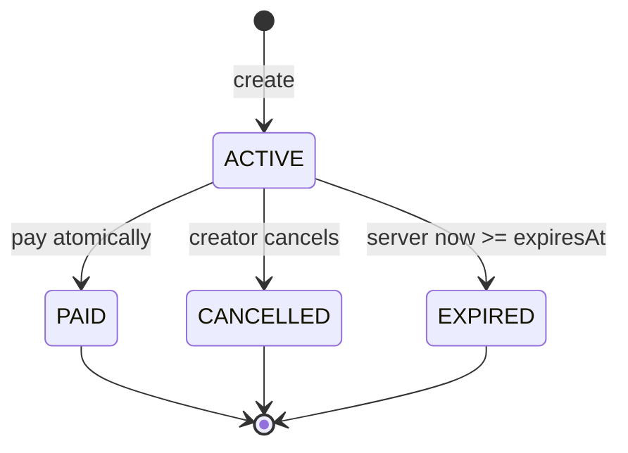

# Especificación técnica — links de cobro QR

Estado: backend implementado y verificado con PostgreSQL real; frontend en desarrollo. Criterios autoritativos: LINK-01..08 y UI-06..09 en `spec.md`. Contratos HTTP: `openapi.yaml` y `browser.openapi.yaml`.

## Decisiones cerradas

- Servicio propietario: `payments`; no hay microservicio ni riel nuevo.
- Cobro interno COP, monto fijo, un pago, expiración exacta a 24 horas y cancelación previa al pago.
- Creador elige cuenta destino propia. Pagador debe iniciar sesión y elegir cuenta origen propia.
- Mientras ACTIVE, cualquier usuario autenticado que posea el QR puede ver el resumen mínimo y pagar. Después, solo creador y pagador efectivo consultan el link/transferencia.
- El link no reserva fondos. El pago crea una transferencia interna COMPLETED; el reverso pertenece al pagador según reglas existentes.
- Auditoría registra solo la transferencia, con `paymentLinkId` opcional. Crear, resolver, compartir, cancelar o expirar no emiten eventos.

## Estados e invariantes

- Solo ACTIVE admite share-token, resolve, pay o cancel.
- `expiresAt = createdAt + 24 h` con reloj del servidor UTC; nunca acepta vencimiento del cliente.
- `transfers.payment_link_id` es nullable y único. Para PAID debe existir exactamente una transferencia INTERNAL cuyo actor/source pertenecen al payer y cuyo destino/monto coinciden con el link.
- `payer_id`, `paid_at` y la transferencia aparecen juntos con PAID; quedan null en otros estados. CANCELLED exige `cancelled_at`; ACTIVE no admite timestamps terminales.
- Estado vivo de lectura proyecta EXPIRED cuando ACTIVE ya venció. Pay/cancel persisten EXPIRED bajo lock antes de responder conflicto.

## Contratos y autorización

| Operación | Auth | Key | Autorización / resultado |
|---|---|---|---|
| POST `/payment-links` | sí | CREATE_PAYMENT_LINK | destinationAccountId propio; 201 PaymentLink |
| GET `/payment-links` | sí | no | solo links creados por actor |
| GET `/payment-links/{id}` | sí | no | creador; también payer si PAID; ajeno 404 |
| GET `/{id}/share-token` | sí | no | creador + ACTIVE; token no-store |
| POST `/payment-links/resolve` | sí | no | token válido + ACTIVE; resumen mínimo, otro caso 404 |
| POST `/payment-links/pay` | sí | PAY_PAYMENT_LINK | token válido, source propia, ACTIVE; 201 PaymentLinkPayment |
| POST `/{id}/cancel` | sí | CANCEL_PAYMENT_LINK | creador + ACTIVE; 200 CANCELLED |

El BFF refleja shapes y status, agrega cookies/JWT, valida Origin en todo POST, reenvía Idempotency-Key y mantiene allowlist exacta. Ningún endpoint es anónimo.

## Token y privacidad

Token: `pl1.<uuid-v4 canónico>.<base64url HMAC-SHA256>`; firma sobre `pl1:<uuid>` con `PAYMENT_LINK_SIGNING_SECRET` de al menos 32 bytes. El adapter valida versión, longitud, UUID y MAC con comparación timing-safe. Firma inválida responde 404 antes de cargar el link.

Payments deriva el token bajo demanda; no lo guarda. Web construye `${APP_ORIGIN}/pay#<token>` y lo retira de la barra al montar. El token nunca entra en query/path, storage, snapshot idempotente, DB, outbox, audit, analytics ni logs. Respuestas de link/token usan `Cache-Control: private, no-store`.

Resolve devuelve exactamente `{linkId, destination:{code,label}, amount, currency, expiresAt}`. No devuelve accountId receptor, creator/payer IDs, email, nombre personal, saldos, historial, status terminal ni motivo por el que un token dejó de resolver.

## Algoritmos transaccionales backend

### Crear

1. Validar JWT, body, monto y key antes de TX.
2. TX: claim `(actor, CREATE_PAYMENT_LINK, key, hash(destinationId,monto,COP))`.
3. Verificar cuenta destino propia; crear UUID, ACTIVE y expiresAt desde Clock.
4. Guardar link y snapshot 201 sin token; commit.

### Pagar

1. Validar body/key; verificar firma y extraer linkId antes de claim. Token inválido no consume key.
2. TX: claim `(actor, PAY_PAYMENT_LINK, key, hash(linkId,sourceAccountId))` y lock link `FOR UPDATE`.
3. Si venció, persistir EXPIRED y responder 409. Si no ACTIVE, 409; token no vuelve a resolver por GET separado.
4. Resolver y bloquear origen/destino por UUID ascendente; comprobar owner, cuenta distinta, disponible y capacidad de crédito.
5. Crear transferencia INTERNAL/COMPLETED con `payment_link_id`, ledger debit/credit y eventos transfer.created/completed; actualizar link PAID/payer/paidAt.
6. Guardar snapshot 201 `{paymentLink,transfer}`; commit único. Cualquier error técnico aborta todo y no consume key.

### Cancelar

1. TX idempotente con namespace CANCEL_PAYMENT_LINK y lock del link.
2. Recurso ajeno 404. ACTIVE vigente pasa a CANCELLED. CANCELLED devuelve el mismo estado. ACTIVE vencido se persiste EXPIRED y responde 409. PAID responde 409.
3. Guardar snapshot y commit; no crear outbox.

## Errores estables

| Condición | HTTP / code | ¿consume key? | Estado del link |
|---|---|---|---|
| JWT/body/key inválidos | 401/400/422 | no | sin cambio |
| token inválido o resolve no ACTIVE | 404 RESOURCE_NOT_FOUND | no | sin cambio |
| destino/origen ajeno o link ajeno | 404 RESOURCE_NOT_FOUND | sí solo si ocurrió dentro de comando reclamado | sin cambio |
| expirado al pagar/cancelar | 409 PAYMENT_LINK_EXPIRED | sí | EXPIRED |
| otro pago ganó | 409 PAYMENT_LINK_ALREADY_PAID | sí | PAID |
| cancelado/no activo autorizado | 409 PAYMENT_LINK_NOT_ACTIVE | sí | terminal existente |
| misma cuenta | 422 SAME_ACCOUNT | sí | ACTIVE |
| fondos/límite | 409 INSUFFICIENT_FUNDS/BALANCE_LIMIT_EXCEEDED | sí | ACTIVE |
| DB/fallo técnico | 503/500 | no por rollback | sin cambio |

## División de trabajo y gates

- Coordinador/backend: dominio, aplicación, adapters, migración, configuración/secreto, contratos/tipos, pruebas PostgreSQL/audit, Compose y documentación central.
- Agente frontend: exclusivamente `apps/web/**` y sección de handoff; UI/BFF, QR y pruebas web conforme a `docs/prompts/payment-links-frontend-agent.md`.
- Gate spec: lint OpenAPI/JSON Schema, tipos regenerados y DBML parseable.
- Evidencia backend actual: `pnpm test` cubre contratos HTTP, firma HMAC, replay, privacidad, 20 pagos concurrentes, error sin efectos parciales, cancelación/expiración y reverso. LINK-01..08 están verificados; rollback link por fallo técnico inyectado después del ledger queda como ampliación (el rollback transaccional base está verificado con transferencias).
- Gate frontend: UI-06..09, typecheck/build/tests, inspección de storage/URL/logs y recorrido browser.
- Gate integrado: A crea, B abre/login/paga, A y B consultan, C recibe 404; saldos, ledger, transferencia y audit coinciden.
